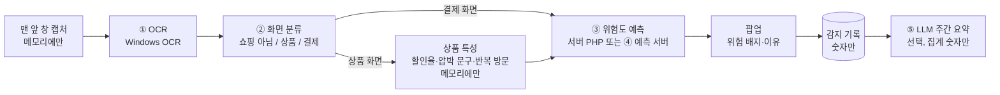

# impulse-guard AI 파이프라인 (발표용)

화면에 보이는 글자만으로 "지금 결제하려는 순간"을 알아내고, 그 결제가 충동구매일 가능성을 숫자와 이유로 보여 준다.
사이트마다 코드를 맞추던 크롬 확장 프로그램(규칙과 선택자)을 접고, 어느 쇼핑몰에서나 같은 방법으로 동작하도록 AI 단계로 바꿨다.

| 단계 | 하는 일 | 방법 | 어디서 | 결과 |
|---|---|---|---|---|
| ① OCR | 캡처한 화면의 글자와 위치 읽기 | Windows 내장 OCR (기본), EasyOCR (대체) | 데스크톱 | 지그재그 결제 화면 0.7~0.9초 (EasyOCR 11초에서 줄임) |
| ② 화면 분류 (C-1) | OCR 글자로 쇼핑 아님 / 상품 화면 / 결제 화면 | 문자 2~4-gram TF-IDF + 로지스틱 회귀. 확률이 낮으면 키워드 규칙 | 데스크톱 (JSON 모델 + numpy) | 판정 0.4ms. 처음 보는 쇼핑몰 실측 11/11 |
| 가격 분석 | 원가, 할인가, 할인율, 결제 금액 | 규칙 점수 (글자 크기, 취소선, 주변 단어) + 할인율 검산 | 데스크톱 | OCR 오인식 금액을 검산으로 거름 |
| ③ 위험도 (C-2) | 이번 결제가 "팝업을 보고도 살" 확률과 이유 | 로지스틱 회귀 17개 특성. 이유 = 특성별 기여(계수 × 표준화 값) 상위 | 서버 PHP (같은 JSON 모델) | AUC 0.710 (지금 규칙 0.590), 낮음/보통/높음 |
| ④ 예측 서버 (C-3) | ③을 API로 제공 | FastAPI, `ai/risk/model.py` 그대로 | 127.0.0.1:8002 (선택) | PHP 계산과 3,032개 비교 차이 2.2e-16. 꺼지면 PHP가 계산 |
| ⑤ LLM 요약 (5) | 이번 주·지난주 기록을 짧은 글로 | Claude API `claude-haiku-5-5`, JSON 응답, 응답 검사 | 예측 서버 (선택) | 숫자는 서버가 미리 계산한 것만 쓰게 하고 검사 |

## ① OCR

- 화면 전체 대신 **맨 앞 창만** 캡처하고, 화면이 바뀌고 멈췄을 때만 읽는다 (3초 간격, 화면 해시 비교)
- 캡처 이미지는 메모리에서 분석하고 버린다. 저장하거나 보내지 않는다
- 작은 글자는 2배로 키워 읽는다. 취소선 원가는 따로 다시 읽는다

## ② 화면 분류 (C-1, `ai/screen/`)

- **왜 AI인가**: 키워드 규칙은 핫딜 게시판, 카드 명세서, 가계부를 85~94% 쇼핑으로 보고, 주문 완료·주문 내역을 절반쯤 쇼핑 화면으로 봤다 (가상 데이터 기준)
- **데이터**: 가상 쇼핑몰 40곳 + 헷갈리는 쇼핑 아님 화면 18종 + OCR 노이즈로 5,760건을 만들었다 (실제 화면을 모으기 어렵고, 개인정보가 들어가므로)
- **결과**

  | 방법 | macro F1 (가상, 처음 보는 몰) | 결제 재현율 | 쇼핑 아님 오탐률 |
  |---|---|---|---|
  | 키워드 규칙 | 0.659 | 0.665 | 0.415 |
  | **문자 n-gram + 로지스틱 회귀** | **0.991** | **0.984** | **0.004** |

  실측: 생성기를 고칠 때 보지 않은 실제 화면 11장(11번가, 컬리, 올리브영, 뉴스, 유튜브 등) 모두 정답. 키워드 규칙은 쇼핑 광고가 있는 뉴스 기사를 틀렸다
- **안전장치**: 모델 확률이 0.5 미만이면 키워드 규칙. 키워드가 결제 화면이고 모델이 상품 화면 0.8 미만이면 결제 화면 (결제를 놓치지 않게)
- 데스크톱에는 scikit-learn을 넣지 않고 JSON 계수를 numpy로 계산한다 (pickle 없음)

## ③ 위험도 (C-2, `ai/risk/`)

- **한 행** = 결제 화면 팝업 1건. **라벨** = 팝업에서 고른 버튼 (그래도 구매 / 담아두기 뒤 참지 못함 = 1, 안 살래요 / 담아두기 성공 = 0)
- **특성** (원시 값 13개 → 모델 특성 17개)
  - 서버 시각: 심야, 늦은 저녁, 주말, 월급일 직후
  - 이번 결제: 금액, 평소 대비 금액 비율, 할인율, 서두르게 하는 문구
  - 데스크톱 상품 화면 행동: 최근 24시간 상품 화면 수, 같은 상품 반복, 머문 시간
  - 과거 기록: 최근 7일 결제 화면 수, 지난 '그래도 구매' 비율, 담아두기 실패 비율
- **결과** (가상 6,000건, 회원 단위 5겹 교차검증): 지금 규칙 AUC 0.590 → **로지스틱 회귀 0.710**, 보정 오차 0.02 이내.
  단계 기준 보통 0.3, 높음 0.55 → 실제 그래도 구매 비율 20% / 41% / 65%
- **이유**: "평균적인 결제보다 위험을 얼마나 올렸나"(계수 × 표준화 값)를 묶어 큰 순서로 최대 3개. 예) "평소 결제 금액의 5배예요."
- **왜 로지스틱 회귀인가**: 그래디언트 부스팅(0.682)보다 낫고, 이유를 설명할 수 있고, PHP로 똑같이 계산할 수 있다
- 포인트와는 연결하지 않는다 (위험도를 일부러 올려 포인트를 받는 악용 방지)

## ④ 예측 서버 (C-3, `ai/serve/`)

- 같은 JSON 모델을 FastAPI로 제공한다. 서버 PHP가 0.3초 안에 답을 못 받거나 모델 버전이 다르면 **PHP가 직접 계산**하고 60초 동안 다시 부르지 않는다
- 결과가 같은지: 모델 예시 32 + 가상 데이터 2,000 + 무작위 1,000개를 양쪽으로 계산해 확률 차이 최대 2.2e-16, 이유 순서 같음
- 의미: 학습 코드(Python)와 서비스 코드가 같은 계산을 쓰고, PHP로 옮기기 어려운 모델과 LLM을 붙일 자리

## ⑤ LLM 주간 요약 (5, 선택)

- 통계 화면 'AI 요약 보기' → 이번 주·지난주 **집계 숫자**(쇼핑몰은 개수만)를 Claude API로 요약
- 차이·배수·비율은 서버가 미리 계산해 보내고 "보낸 숫자만 쓰라"고 지시한다. 응답에 보낸 적 없는 숫자가 있으면 버린다
- 팝업 문구에는 쓰지 않았다: 새 정보 없이 말만 바뀌고, 문구가 사용자의 결정(=③의 라벨)을 바꾸기 때문

## 한계 (발표에서 숨기지 않을 것)

1. **가상 데이터**: ②③ 모두 가상 데이터로 학습했다. 우리가 정한 효과를 모델이 다시 배운 것이라 실제 성능의 증거가 아니다. 그래서 예측할 때 원시 값과 모델 버전을 기록해 두었다 (실제 결정과 짝지어 다시 평가)
2. **실측이 적다**: 화면 분류 실측은 18장, 결제 화면은 대부분 넓은 데스크톱 창이다
3. **'그래도 구매' ≠ 충동구매**: 필요한 물건을 계획대로 사도 1이다. 위험도는 "개입해도 살 가능성"에 가깝다
4. **'안 살래요'에는 포인트가 붙는다**: 포인트를 바라고 누른 결정이 라벨에 섞인다
5. **OCR 오인식**: 배송비·리뷰 수·포인트를 가격으로 읽는 경우가 남아 있다 (`docs/LIMITATIONS.md`)

자세한 근거: `ai/screen/README.md`, `ai/risk/README.md`, `ai/serve/README.md`, `docs/PROGRESS.md`
